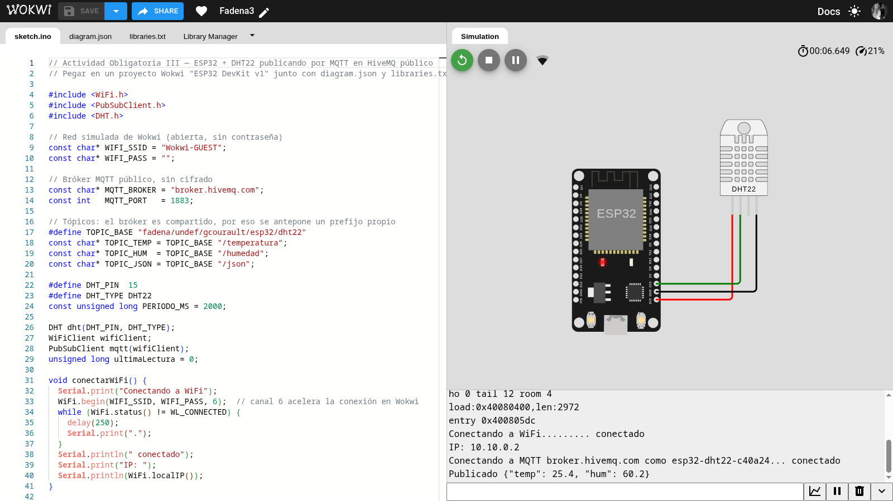
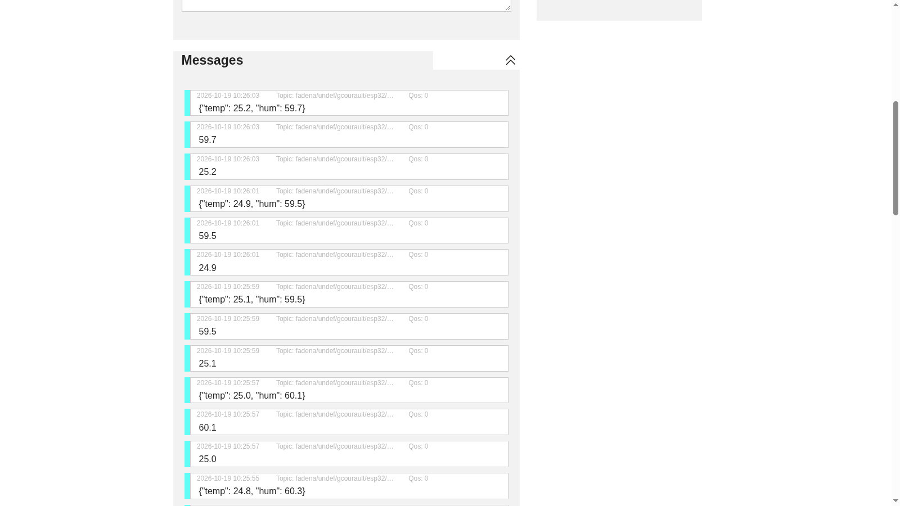
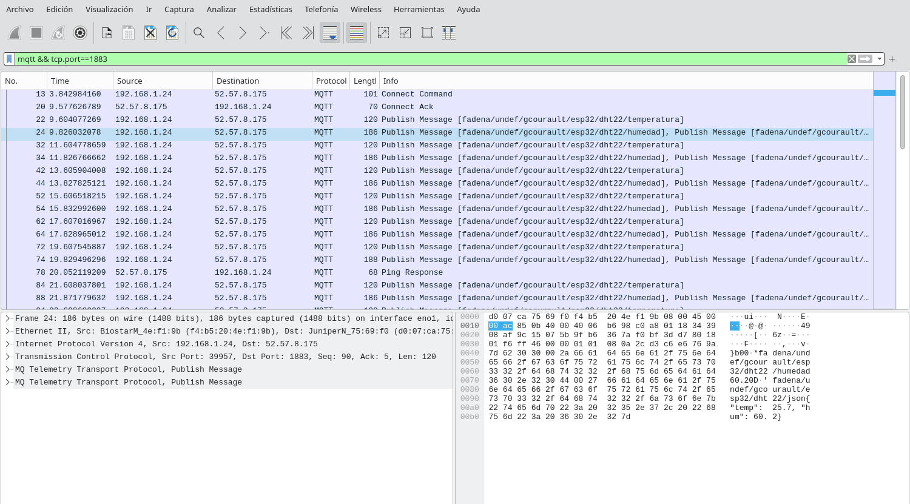

# Actividad Obligatoria III — Simulación en Wokwi de ESP32 + DHT22 con MQTT (HiveMQ) y análisis en Wireshark

**Licenciatura en Ciberdefensa — Dispositivos Remotos e Internet de las Cosas (FADENA / UNDEF) — 2026**

Autor: Gustavo Courault — Fork: `github.com/gcourault/iot_repo`

---

## 1. Entorno y procedimiento

| Ítem | Valor |
|---|---|
| Simulador | Wokwi (web), placa **ESP32 DevKit v1** + sensor **DHT22** |
| Firmware | Arduino C++: `WiFi.h`, `PubSubClient.h`, `DHT.h` |
| Sistema de captura | Debian 12.15, kernel 6.1.0-53-amd64, Wireshark / tshark / dumpcap 4.0.17 |
| Python / librería | 3.12.14 / paho-mqtt 2.1.0 |
| Bróker | `broker.hivemq.com` (público), TCP **1883** sin cifrado |
| Tópicos | `fadena/undef/gcourault/esp32/dht22/{temperatura,humedad,json}` |
| Interfaz capturada | `eno1` (Ethernet, 192.168.1.24/23, gateway 192.168.1.1) |

Los tópicos del manual (`esp32/dht22/...`) se prefijaron con `fadena/undef/gcourault/` porque el
bróker es compartido con todo Internet: cualquier otro alumno que publique en `esp32/dht22/#` se
mezclaría con estos datos.

### 1.1 Archivos

| Archivo | Rol |
|---|---|
| `wokwi/sketch.ino` | Firmware del ESP32: WiFi → MQTT → lectura del DHT22 cada 2 s → publicación |
| `wokwi/diagram.json` | Circuito: DHT22 VCC→3V3, GND→GND, DATA→D15 |
| `wokwi/libraries.txt` | PubSubClient, DHT sensor library, Adafruit Unified Sensor |
| `esp32_dht22_twin.py` | **Gemelo** del firmware en Python (ver §1.2) |
| `capturas/act3/esp32_twin_eno1.pcapng` | Captura en `eno1`, filtro `tcp port 1883 or tcp port 8000`, 191 paquetes |
| `capturas/act3/esp32_twin.log` | Log del publicador (15 lecturas) |
| `capturas/act3/hivemq_ws_cliente.log` | Log del suscriptor MQTT sobre WebSocket (45 mensajes) |
| `capturas/act3/Screenshot_20261019_101650.png` | Wokwi en ejecución |
| `capturas/act3/Screenshot_20261019_102603.png` | Cliente web de HiveMQ recibiendo datos |
| `capturas/act3/wireshark_mqtt_publish.png` | Wireshark mostrando los paquetes MQTT y el payload en claro |

### 1.2 Por qué un gemelo en Python para la captura

En el simulador **web** de Wokwi, la red `Wokwi-GUEST` no es la red de la PC: el ESP32 virtual
obtiene la IP `10.10.0.2` (ver captura de pantalla) dentro de una red NAT de Wokwi, y su tráfico sale
a Internet por el **IoT Gateway de Wokwi en la nube**. Entre el navegador y Wokwi sólo viaja un
túnel cifrado. Por lo tanto, capturando en `eno1` **no aparece** el MQTT/1883 del ESP32 hacia HiveMQ,
y el análisis por capas que pide el manual no es posible sobre ese tráfico.

Para poder hacerlo, `esp32_dht22_twin.py` reproduce el comportamiento del firmware **desde la PC**:
mismos tópicos, mismo payload `{"temp": .., "hum": ..}`, mismo período (2 s) y mismo keepalive
(15 s), con un DHT22 virtual que hace un paseo aleatorio en torno a 25,4 °C / 60,2 %. A nivel de red
es indistinguible del ESP32: un cliente MQTT 3.1.1 que abre una conexión TCP al 1883 de HiveMQ y
publica en texto plano.

> Alternativa sin gemelo: la extensión **Wokwi para VS Code** con el *Private IoT Gateway* hace que
> el tráfico del ESP32 simulado salga por la propia PC, y entonces sí se captura en `eno1`.

---

## 2. Funcionamiento

### 2.1 ESP32 simulado en Wokwi

La simulación compiló y se ejecutó con el firmware de `wokwi/sketch.ino`. Monitor serial
(`Screenshot_20261019_101650.png`):

```
Conectando a WiFi......... conectado
IP: 10.10.0.2
Conectando a MQTT broker.hivemq.com como esp32-dht22-c40a24... conectado
Publicado {"temp": 25.4, "hum": 60.2}
```

Se verifican los tres puntos del manual: conexión WiFi exitosa, conexión MQTT y publicación
periódica. Los valores 25,4 °C y 60,2 % son los configurados en el DHT22 del diagrama, lo que
confirma la lectura correcta del sensor por GPIO 15. El *Client ID* incluye parte de la MAC del
ESP32 (`c40a24`) para que sea único en el bróker público.



### 2.2 Suscripción desde el cliente web de HiveMQ

En el *Websockets Client Showcase* de HiveMQ se suscribió `fadena/undef/gcourault/esp32/dht22/#`
(QoS 0). Llegan las tres publicaciones de cada lectura —temperatura, humedad y JSON— cada 2 s
(`Screenshot_20261019_102603.png`). Esos mensajes corresponden a una ejecución del gemelo
(10:25:55–10:26:03).



**Puerto 8884 en lugar de 8000.** El manual indica el 8000 (WebSocket sin cifrar), pero la página
del cliente se sirve por `https://`, y el navegador bloquea un `ws://` desde una página segura
(*mixed content*): la conexión fallaba con `AMQJSC0001E Connect timed out`. Se usó el 8884
(WebSocket sobre TLS, `wss://`). Esto sólo afecta al tramo navegador–bróker; el tramo que se analiza,
dispositivo–bróker, sigue siendo MQTT en claro por el 1883.

### 2.3 Experimento capturado

Con `dumpcap` corriendo en `eno1`, se lanzaron en paralelo el suscriptor `hivemq_ws_client.py`
—que hace lo mismo que el cliente web: MQTT dentro de un WebSocket a `broker.hivemq.com:8000/mqtt`—
y el gemelo con 15 lecturas:

```
✓ Conectado a MQTT broker.hivemq.com:1883 como esp32-dht22-twin-9312 → Success
[09:51:11.483] Publicado #1 {"temp": 25.7, "hum": 60.2}
...
[09:51:39.491] Publicado #15 {"temp": 25.5, "hum": 60.5}
```

```
✓ Conectado por ws://broker.hivemq.com:8000/mqtt → Success
[09:51:11.714] fadena/undef/gcourault/esp32/dht22/temperatura (qos 0, 4 bytes): 25.7
[09:51:11.937] fadena/undef/gcourault/esp32/dht22/json (qos 0, 27 bytes): {"temp": 25.7, "hum": 60.2}
[09:51:11.937] fadena/undef/gcourault/esp32/dht22/humedad (qos 0, 4 bytes): 60.2
...
Total de mensajes recibidos por WebSocket: 45
```

**45 de 45** mensajes recibidos (15 lecturas × 3 tópicos), con ~230 ms entre publicación y
recepción: el dato sale de la PC, llega a HiveMQ y vuelve por otra conexión.

---

## 3. Análisis por capas del modelo de red

La captura contiene dos conversaciones TCP con la misma IP de HiveMQ:

| Conversación | Rol | Tramas | Bytes |
|---|---|---|---|
| `192.168.1.24:39957 ↔ 52.57.8.175:1883` | dispositivo (MQTT) | 81 | 8.025 |
| `192.168.1.24:34325 ↔ 52.57.8.175:8000` | suscriptor (MQTT sobre WebSocket) | 110 | 10.461 |

Filtros usados en Wireshark: `tcp.port == 1883` y `mqtt`.

### 3.1 Capa 7 — Aplicación: MQTT

Secuencia completa de la conexión del dispositivo:

| Trama | t (s) | Sentido | Mensaje MQTT | Trama |
|---|---|---|---|---|
| 13 | 3,84 | dispositivo → bróker | **CONNECT** (tipo 1) | 101 B |
| 20 | 9,58 | bróker → dispositivo | **CONNACK** (2) | 70 B |
| 22 | 9,60 | dispositivo → bróker | **PUBLISH** (3) `.../temperatura` | 120 B |
| 24 | 9,83 | dispositivo → bróker | **PUBLISH** `.../humedad` + **PUBLISH** `.../json` | 186 B |
| 74 | 19,83 | dispositivo → bróker | ... + **PINGREQ** (12) | |
| 78 | 20,05 | bróker → dispositivo | **PINGRESP** (13) | 68 B |
| 154 / 156 | 34,61 / 34,84 | | PINGREQ / PINGRESP | 68 B |
| 178 / 180 | 49,62 / 49,85 | | PINGREQ / PINGRESP | 68 B |
| 188 | 56,61 | dispositivo → bróker | **DISCONNECT** (14) | 68 B |

Recuento por tipo: 1 CONNECT, 1 CONNACK, **45 PUBLISH**, 3 PINGREQ, 3 PINGRESP, 1 DISCONNECT.
Los PINGREQ salen **exactamente cada 15 s**, el keepalive declarado en el CONNECT. Con QoS 0 no hay
PUBACK: un PUBLISH por mensaje y nada más.

El CONNECT, decodificado por Wireshark, expone la identidad del cliente sin ninguna protección:

```
Protocol Name: MQTT
Version: MQTT v3.1.1 (4)
Connect Flags: 0x02 (Clean Session; sin usuario ni contraseña)
Keep Alive: 15
Client ID: esp32-dht22-twin-9312
```

**Texto plano.** Volcado hexadecimal de la trama 24, donde se leen tópico y payload directamente
en la columna ASCII:

```
0060  33 32 2f 64 68 74 32 32 2f 68 75 6d 65 64 61 64   32/dht22/humedad
0070  36 30 2e 32 30 44 00 27 66 61 64 65 6e 61 2f 75   60.20D.'fadena/u
0080  6e 64 65 66 2f 67 63 6f 75 72 61 75 6c 74 2f 65   ndef/gcourault/e
0090  73 70 33 32 2f 64 68 74 32 32 2f 6a 73 6f 6e 7b   sp32/dht22/json{
00a0  22 74 65 6d 70 22 3a 20 32 35 2e 37 2c 20 22 68   "temp": 25.7, "h
00b0  75 6d 22 3a 20 36 30 2e 32 7d                     um": 60.2}
```

La misma trama en Wireshark, con el filtro `mqtt && tcp.port==1883`: en la lista se ven el CONNECT,
el CONNACK, los PUBLISH a cada tópico y un PINGRESP; en el detalle, las cabeceras Ethernet, IPv4 y
TCP (capas 2, 3 y 4) seguidas de los dos PUBLISH; y en el panel de bytes, el JSON en ASCII:



Se distinguen los campos del PUBLISH: `30 44` es la cabecera fija (tipo 3, longitud restante 68),
`00 27` la longitud del tópico (39 bytes), luego el tópico y a continuación el JSON. Cualquiera que
vea el tráfico conoce **qué** mide el dispositivo, **dónde** lo publica y **cuánto** vale.

**Conclusión de capa 7: MQTT sin TLS no ofrece confidencialidad ni autenticación.** Un atacante en el
camino no sólo puede leer las mediciones: con el mismo tópico y sin credenciales podría publicar
valores falsos que el suscriptor aceptaría como legítimos.

### 3.2 Capa 4 — Transporte: TCP

| Campo | Valor observado |
|---|---|
| Protocolo | TCP (IP proto 6) |
| Puerto destino | **1883** (MQTT sin cifrar, IANA) |
| Puerto origen | **39957**, efímero (> 1024), elegido por el sistema |
| Handshake | trama 10 `SYN` → 11 `SYN, ACK` → 12 `ACK` |
| RTT del handshake | **222 ms** (SYN → SYN/ACK) |
| MSS negociado | 1460 en ambos sentidos (Ethernet 1500 − 20 IP − 20 TCP) |
| Opciones | SACK permitido, *timestamps*, *window scale* (×128 cliente, ×256 bróker) |
| Cierre | `DISCONNECT` → `FIN, ACK` / `FIN, ACK` / `ACK` (tramas 188–191) |
| Retransmisiones | **0** |

**Control de errores.** Cada segmento con datos recibe su ACK acumulativo: tras el PUBLISH de 54
bytes de la trama 22 (Seq 36), el bróker responde `Ack=90` (trama 23). El número de secuencia
avanza exactamente con los bytes MQTT enviados, que es como TCP garantiza orden y entrega. No hubo
pérdidas, pero el mecanismo está ahí: si un ACK no llega, el segmento se retransmite.

**Agregación de segmentos.** Las tramas 24, 34, 44… llevan **dos** PUBLISH en un mismo segmento
(humedad + JSON, 120 bytes de datos). Es el algoritmo de Nagle: mientras haya un segmento sin
confirmar en vuelo, TCP acumula lo que la aplicación escribe y lo envía junto. Para MQTT no es un
problema porque cada paquete lleva su propia longitud y el receptor los separa sin ambigüedad.

**Latencia del bróker público.** El CONNACK tardó **5,7 s** en llegar (trama 13 → trama 20), aunque
el ACK TCP del CONNECT llegó a los 222 ms (trama 14). TCP entregó el CONNECT al bróker de inmediato;
la demora es del bróker, que estaba cargado. Por eso el gemelo espera el CONNACK antes de publicar
(lección de la Actividad 2, §5.1); el firmware con PubSubClient hace lo mismo, porque `connect()`
bloquea hasta recibirlo.

### 3.3 Capa 3 — Red: IPv4

| Campo | Saliente (trama 10) | Entrante (trama 11) |
|---|---|---|
| IP origen | **192.168.1.24** (red local privada) | 52.57.8.175 |
| IP destino | **52.57.8.175** (HiveMQ, pública) | 192.168.1.24 |
| TTL | 64 | **246** |
| Protocolo | 6 (TCP) | 6 (TCP) |
| Flags | DF (no fragmentar) | DF |

`broker.hivemq.com` resolvió en esta ocasión a `52.57.8.175`, una dirección de AWS (región
Frankfurt, igual que en la Actividad 2, aunque **otra IP del clúster**: entonces fue
`18.185.58.114`). El bróker es un clúster detrás de varias direcciones y el DNS reparte las
conexiones.

**Diferencia clave con las actividades anteriores:** en la Actividad 1 el tráfico iba de
`127.0.0.1` a `127.0.0.1` sin salir de la máquina. Aquí la IP destino es **pública** y el paquete
atraviesa Internet. El TTL de los paquetes entrantes (246) lo muestra: si, como es habitual, el
bróker los emite con TTL 255, llegan habiendo perdido 9, es decir, después de **unos 9 saltos de
router**.

Lo que Wireshark ve en la PC es la dirección **privada** 192.168.1.24. HiveMQ, en cambio, ve la IP
pública del router: el NAT del gateway reescribe el origen al salir. Lo mismo ocurre, un nivel más
arriba, con el ESP32 de Wokwi: su `10.10.0.2` sólo existe dentro de la red simulada.

### 3.4 Capa 2 — Enlace: Ethernet

| Campo | Valor |
|---|---|
| MAC origen | `f4:b5:20:4e:f1:9b` (NIC `eno1` de esta PC) |
| MAC destino | `d0:07:ca:75:69:f0` (**router/gateway** 192.168.1.1) |
| EtherType | `0x0800` (IPv4) |

La MAC destino **no es la de HiveMQ**, sino la del router. La tabla ARP lo confirma:

```
$ ip neigh show 192.168.1.1
192.168.1.1 dev eno1 lladdr d0:07:ca:75:69:f0 REACHABLE
```

La PC sabe por su tabla de rutas (`default via 192.168.1.1 dev eno1`) que 52.57.8.175 no está en su
red local, así que encapsula el paquete IP en una trama Ethernet dirigida al gateway. El paquete
viaja primero por la LAN y el router lo reenvía hacia Internet con un **nuevo** encabezado de capa 2;
la IP destino se mantiene de extremo a extremo, las MAC cambian en cada salto.

### 3.5 Resumen del encapsulado

```
Ethernet  f4:b5:20:4e:f1:9b → d0:07:ca:75:69:f0   (capa 2: hasta el router)
 └ IPv4   192.168.1.24 → 52.57.8.175, TTL 64      (capa 3: hasta HiveMQ)
    └ TCP 39957 → 1883                            (capa 4: proceso MQTT del bróker)
       └ MQTT PUBLISH  fadena/undef/gcourault/esp32/dht22/json   (capa 7)
          └ {"temp": 25.7, "hum": 60.2}           ← legible por cualquiera en el camino
```

---

## 4. Verificación de seguridad del mensaje

| Configuración | ¿Se ve el mensaje? | Evidencia |
|---|---|---|
| MQTT, puerto **1883** | ✔ **Sí** | Esta actividad: tópico y JSON legibles en el volcado (§3.1) |
| MQTT sobre TLS, puerto **8883** | ✘ **No** | Actividad 1 (`capturas/tls_eno1.pcapng`): tras el *handshake* TLS sólo hay `Application Data` cifrado |
| MQTT/WebSocket, puerto **8000** | ✔ Sí | Suscriptor de esta captura: MQTT dentro de tramas WebSocket sin cifrar |
| MQTT/WebSocket seguro, **8884** | ✘ No | Cliente web del navegador (§2.2): `wss://`, cifrado TLS |
| Wokwi web → nube de Wokwi | ✘ No | El ESP32 simulado se tuneliza cifrado hasta el gateway de Wokwi (§1.2) |

Este último caso tiene un matiz: que la captura local no muestre el MQTT del ESP32 de Wokwi **no**
significa que esté protegido. El gateway de Wokwi lo reenvía a HiveMQ por el 1883 en claro, de modo
que es igual de legible para cualquiera entre la nube de Wokwi y HiveMQ, y para cualquier suscriptor
del bróker público que adivine o barra los tópicos (`#`).

---

## 5. Conclusiones

1. **El escenario IoT completo funciona.** Un ESP32 simulado lee un DHT22 por GPIO 15, se conecta a
   la WiFi de Wokwi, publica en un bróker público y los datos se ven en tiempo real desde un
   navegador cualquiera. Ninguno de los extremos conoce al otro: sólo comparten el nombre de un
   tópico.

2. **Sin cifrado, los datos IoT se leen sin esfuerzo.** En el puerto 1883 Wireshark muestra el
   *Client ID*, el tópico y cada medición en ASCII. Tampoco hay autenticación: el CONNECT no lleva
   usuario ni contraseña, y cualquiera podría publicar lecturas falsas en el mismo tópico. En un
   sistema real hacen falta **MQTT sobre TLS (8883)**, credenciales o certificados de cliente y
   control de acceso por tópico en el bróker.

3. **Las cuatro capas cuentan una historia coherente.** La capa 2 lleva la trama sólo hasta el
   router (MAC del gateway); la capa 3 la lleva hasta AWS Frankfurt, a unos 9 saltos (IP pública,
   TTL 246); la capa 4 la entrega con fiabilidad al proceso MQTT del bróker (TCP 1883, handshake,
   ACKs, sin retransmisiones); y la capa 7 aporta la semántica IoT (CONNECT, PUBLISH, PINGREQ cada
   15 s según el keepalive negociado).

4. **Simular no es lo mismo que capturar.** Wokwi resuelve el hardware pero esconde la red: su
   gateway en la nube tuneliza el tráfico del ESP32. Para el análisis de red hizo falta un gemelo que
   generara el mismo tráfico desde la PC, o, como alternativa, el gateway privado de Wokwi en
   VS Code.
